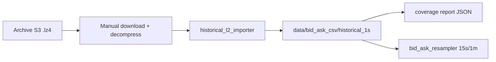

# Hyperliquid Historical L2 Backfill Plan

Read-only research and importer skeleton for converting Hyperliquid historical L2
archive snapshots into bid/ask CSV rows. This phase does **not** download archive data
by default.

## Safety

- Read-only, research-only, paper-only
- No wallets, keys, signing, orders, or execution endpoints
- No live trading, private APIs, or user account data
- No automatic AWS/S3 downloads in this phase
- Do not start `main.py` or `websocket_recorder.py` for backfill work

## Historical Facts

### Live data

Hyperliquid live WebSocket **BBO** provides best bid/ask updates. The project's
existing recorder and `bid_ask_extractor` pipeline can turn locally captured BBO or
L2 messages into 1-second bid/ask CSV rows.

### Historical archive

Hyperliquid publishes historical **L2 book snapshots** in the public requester-pays
archive bucket:

```text
s3://hyperliquid-archive/market_data/[YYYYMMDD]/[hour]/l2Book/[COIN].lz4
```

Example:

```text
s3://hyperliquid-archive/market_data/20230916/9/l2Book/SOL.lz4
```

Each `.lz4` file holds JSON lines for one coin and one hour. After decompression,
each line is an L2 snapshot with `levels` (bids and asks). Snapshots are emitted
about **twice per second**, not necessarily every second.

### Archive cadence and reliability

- Historical archive is uploaded **about once a month**
- Data **may be missing** and is **not guaranteed timely**
- There is no SLA for complete hourly coverage across all coins

### API limitations

Hyperliquid `candleSnapshot` only supports **1m+ intervals** and the **most recent
5000 candles**. It cannot reconstruct sub-minute bid/ask history for all time.

### What we do not claim

**All-time 1-second bid/ask is not directly available** from a single public source.
Any 1-second series derived from archive L2 must be validated for gaps, duplicates,
and missing hours before use in research or training.

## Best Path Forward

1. **Inspect paths** — print expected S3 locations without downloading
2. **Download manually** (future phase) — requester-pays S3 copy + local `unlz4`
3. **Import locally** — parse decompressed files with `historical_l2_importer.py`
4. **Extract top of book** — best bid/ask and sizes from L2 `levels`
5. **Validate coverage** — row counts, missing seconds, duplicates, invalid quotes
6. **Resample** — use existing `bid_ask_resampler` for 15s/1m intervals



## Module Overview

| File | Purpose |
| --- | --- |
| `historical_backfill_research.py` | Research constants, facts, and summary helpers |
| `historical_l2_importer.py` | Path builder, parser, local importer, coverage summary, CLI |
| `tests/test_historical_l2_importer.py` | Offline tests with fake L2 lines |
| `docs/historical_backfill_plan.md` | This document |

## Importer Functions

### `build_archive_s3_path(date, hour, coin, datatype="l2Book")`

Returns the expected archive path, e.g.:

```text
s3://hyperliquid-archive/market_data/20230916/9/l2Book/SOL.lz4
```

### `parse_l2_snapshot_line(line)`

Parses one decompressed JSON line. Extracts:

- `timestamp_ms`, `coin`, `best_bid`, `best_ask`, `bid_size`, `ask_size`
- `source_channel = historical_l2Book`

Malformed rows return `None` and are skipped safely.

### `l2_snapshot_to_bid_ask_row(snapshot)`

Converts parsed top-of-book into the standard bid/ask CSV schema used by
`bid_ask_schema.py`, with:

- `source_session_id = historical_archive`
- `source_channel = historical_l2Book`

### `import_decompressed_l2_file(input_path, coin, output_path)`

Reads a **local decompressed file only**. Writes CSV under:

```text
data/bid_ask_csv/historical_1s/
```

### `summarize_historical_coverage(csv_path)`

Returns coverage metrics:

- row count, start/end timestamps
- missing seconds, duplicate timestamps, invalid bid/ask rows
- `source = historical_archive_l2Book`

### `write_historical_import_report(...)`

Saves JSON under:

```text
data/bid_ask_csv/reports/
```

## CLI Commands

Print expected S3 path (no download):

```bash
python3 historical_l2_importer.py inspect-path --date 20230916 --hour 9 --coin SOL
```

Import a local decompressed file:

```bash
python3 historical_l2_importer.py import-local --input /path/to/decompressed/SOL --coin SOL
```

Optional output path:

```bash
python3 historical_l2_importer.py import-local \
  --input /tmp/SOL \
  --coin SOL \
  --output data/bid_ask_csv/historical_1s/SOL_1s.csv
```

## Output Layout

```text
data/bid_ask_csv/
  historical_1s/
    SOL_1s.csv
  reports/
    historical_SOL_20230916T090000Z.json
```

Historical CSV columns match `BID_ASK_CSV_COLUMNS` in `bid_ask_schema.py`.

## Future Work (Not in This Phase)

- Requester-pays S3 downloader with explicit opt-in
- Hour-range batch import and deduplication across files
- Integration hook in `bid_ask_data_pipeline.py` for `--source historical`
- Gap-fill policy documentation (forward-fill vs leave missing)

## References

- [Hyperliquid historical data docs](https://hyperliquid.gitbook.io/hyperliquid-docs/historical-data)
- Archive format: `market_data/[date]/[hour]/l2Book/[coin].lz4`
- Decompression: `unlz4` or system `lz4` package
