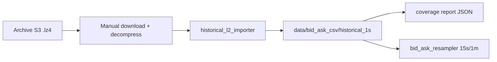

# Hyperliquid Historical L2 Backfill Plan

Read-only research and importer skeleton for converting Hyperliquid historical L2
archive snapshots into bid/ask CSV rows. This phase does **not** download archive data
by default.

## Safety

- Read-only, research-only, paper-only
- No wallets, keys, signing, orders, or execution endpoints
- No live trading, private APIs, or user account data
- No automatic bulk AWS/S3 downloads; optional tiny sample downloader with hard caps
- Do not start `main.py` or `websocket_recorder.py` for backfill work

## Historical Facts

### Live data

Hyperliquid live WebSocket **BBO** provides best bid/ask updates. The project's
existing recorder and `bid_ask_extractor` pipeline can turn locally captured BBO or
L2 messages into 1-second bid/ask CSV rows.

### Historical archive

Hyperliquid publishes historical **L2 book snapshots** in the public requester-pays
archive bucket:

```text
s3://hyperliquid-archive/market_data/[YYYYMMDD]/[hour]/l2Book/[COIN].lz4
```

Example:

```text
s3://hyperliquid-archive/market_data/20230916/9/l2Book/SOL.lz4
```

Each `.lz4` file holds JSON lines for one coin and one hour. After decompression,
each line is an L2 snapshot with `levels` (bids and asks). Snapshots are emitted
about **twice per second**, not necessarily every second.

### Archive cadence and reliability

- Historical archive is uploaded **about once a month**
- Data **may be missing** and is **not guaranteed timely**
- There is no SLA for complete hourly coverage across all coins

### API limitations

Hyperliquid `candleSnapshot` only supports **1m+ intervals** and the **most recent
5000 candles**. It cannot reconstruct sub-minute bid/ask history for all time.

### What we do not claim

**All-time 1-second bid/ask is not directly available** from a single public source.
Any 1-second series derived from archive L2 must be validated for gaps, duplicates,
and missing hours before use in research or training.

## Best Path Forward

1. **Inspect paths** — print expected S3 locations without downloading
2. **Download sample** — manual `aws`/`lz4` CLI or Python-native tiny sample (`historical_l2_python_downloader.py`)
3. **Import locally** — parse decompressed files with `historical_l2_importer.py`
4. **Extract top of book** — best bid/ask and sizes from L2 `levels`
5. **Validate coverage** — row counts, missing seconds, duplicates, invalid quotes
6. **Resample** — use existing `bid_ask_resampler` for 15s/1m intervals



## Required Local Tools

Manual historical backfill (Phase 2 download/decompress) depends on external CLI
tools installed on your machine. The aws CLI is needed for manual S3 copy; lz4 is
needed for decompression. The repo does **not** install or download anything
automatically — no automatic installs and no automatic downloads.

| Tool | Required? | Purpose |
| --- | --- | --- |
| `aws` CLI | **Yes** (manual download) | AWS CLI for requester-pays S3 copy from `hyperliquid-archive` |
| `lz4` | **Yes** (manual download) | Decompress `.lz4` archive files to JSONL |
| `brew` | Optional (macOS) | One possible install method for `aws` and `lz4`; not required |

Check what is available locally:

```bash
python3 historical_backfill_tool_check.py
```

The diagnostic uses `shutil.which` only — no subprocess execution, no network calls,
and no automatic installs. If `aws` or `lz4` is missing, `ready_for_manual_download`
is false; you can still capture bid/ask CSV rows via the local BBO recorder workflow.

## Manual Phase 2 Workflow

Phase 2 adds a manual-first guide (`historical_backfill_manual_guide.py`) that prints
commands for the user to run locally. **Nothing is downloaded, decompressed, or
executed automatically.**

### Why manual first

- Archive files are large and requester-pays; bulk downloads are easy to misconfigure
- One coin + one hour is enough to validate parsing, schema compatibility, and coverage
- Keeps the workflow read-only and safe until coverage metrics look acceptable
- Avoids accidental network/subprocess automation in research tooling

### Inspect path

Confirm the expected object before downloading:

```bash
python3 historical_l2_importer.py inspect-path --date 20230916 --hour 9 --coin SOL
```

Or print the full manual plan (commands only, no execution):

```bash
python3 historical_backfill_manual_guide.py --date 20230916 --hour 9 --coin SOL
```

For a manifest-driven batch of commands (still manual execution only):

```bash
python3 historical_l2_download_commands.py --latest --limit 3
```

Reports land under `reports/historical_l2_download_commands/` with mkdir, download,
decompress, and import sections. Start with `--limit 3`, validate coverage, then expand.

### Download a tiny sample with Python (no AWS/lz4 CLI)

For a controlled one-file sample without the AWS or lz4 CLI:

```bash
python3 historical_l2_python_downloader.py --latest --max-files 1
```

Or point at a specific command plan:

```bash
python3 historical_l2_python_downloader.py \
  --plan reports/historical_l2_download_commands/historical_l2_download_commands_20230916_20230916_BTC_ETH_SOL.json \
  --max-files 1
```

Safety caps:

- Default `--max-files` is **1**
- Hard cap **3** without `--allow-more`
- Hard cap **24** with `--allow-more` (still no all-time downloads)

Outputs:

- `downloads/hyperliquid/{date}/{hour}/{coin}.lz4` and `.jsonl`
- Reports under `reports/historical_l2_python_downloads/`

Uses unsigned public S3 access (`boto3` + `UNSIGNED` config) and Python `lz4.frame`
decompression. No wallets, keys, or trading endpoints.

### Download one hour manually

Run the printed `aws s3 cp --no-sign-request ...` command in your shell. Example:

```bash
aws s3 cp --no-sign-request \
  s3://hyperliquid-archive/market_data/20230916/9/l2Book/SOL.lz4 \
  ./downloads/hyperliquid/20230916/9/SOL.lz4
```

Download **one hour for one coin** first. Do not bulk-fetch months of data until a
sample import validates cleanly.

### Decompress one hour manually

```bash
lz4 -d ./downloads/hyperliquid/20230916/9/SOL.lz4 \
  ./downloads/hyperliquid/20230916/9/SOL.jsonl
```

Use local `lz4` or `unlz4`. The importer reads the decompressed JSONL file only.

### Import local decompressed file

```bash
python3 historical_l2_importer.py import-local \
  --input ./downloads/hyperliquid/20230916/9/SOL.jsonl \
  --coin SOL
```

Output CSV lands under `data/bid_ask_csv/historical_1s/` with:

- `source_session_id = historical_archive`
- `source_channel = historical_l2Book`

### Validate

Historical L2-derived bid/ask is stored separately from live WebSocket BBO. Use the
historical summarize CLI (not `bid_ask_data_pipeline.py validate`, which targets live
recorder output):

```bash
python3 historical_l2_importer.py summarize \
  --csv data/bid_ask_csv/historical_1s/SOL_1s.csv
```

Review the JSON report under `data/bid_ask_csv/reports/` for row counts, missing
seconds, duplicates, and invalid quotes.

### Avoid huge downloads

- Start with a single `(date, hour, coin)` tuple
- Check archive availability with `inspect-path` before paying for S3 transfer
- Expand hour-by-hour only after coverage reports look acceptable
- Do not claim all-time 1-second BBO without validating each imported segment

### Label historical vs live BBO

| Source | CSV location | Session / channel labels |
| --- | --- | --- |
| Live WebSocket BBO | `data/bid_ask_csv/1s/` (via recorder) | recorder session IDs, live channels |
| Historical archive L2 | `data/bid_ask_csv/historical_1s/` | `historical_archive`, `historical_l2Book` |

Keep historical and live CSVs in separate directories. Do not merge them without an
explicit deduplication and provenance policy.

## Module Overview

| File | Purpose |
| --- | --- |
| `historical_backfill_tool_check.py` | PATH diagnostic for `brew`/`aws`/`lz4` (shutil.which only) |
| `historical_l2_backfill_planner.py` | Offline date-range manifest planner (S3 paths only, no download) |
| `historical_l2_download_commands.py` | Manifest-driven batch command generator (mkdir/download/decompress/import) |
| `historical_l2_python_downloader.py` | Python-native tiny sample downloader (unsigned S3 + lz4 library, hard-capped) |
| `historical_backfill_manual_guide.py` | Manual download/decompress/import command strings and step plan |
| `historical_backfill_research.py` | Research constants, facts, and summary helpers |
| `historical_l2_importer.py` | Path builder, parser, local importer, coverage summary, CLI |
| `tests/test_historical_backfill_manual_guide.py` | Offline tests for manual guide commands and safety |
| `tests/test_historical_l2_importer.py` | Offline tests with fake L2 lines |
| `docs/historical_backfill_plan.md` | This document |

## Importer Functions

### `build_archive_s3_path(date, hour, coin, datatype="l2Book")`

Returns the expected archive path, e.g.:

```text
s3://hyperliquid-archive/market_data/20230916/9/l2Book/SOL.lz4
```

### `parse_l2_snapshot_line(line)`

Parses one decompressed JSON line. Extracts:

- `timestamp_ms`, `coin`, `best_bid`, `best_ask`, `bid_size`, `ask_size`
- `source_channel = historical_l2Book`

Malformed rows return `None` and are skipped safely.

### `l2_snapshot_to_bid_ask_row(snapshot)`

Converts parsed top-of-book into the standard bid/ask CSV schema used by
`bid_ask_schema.py`, with:

- `source_session_id = historical_archive`
- `source_channel = historical_l2Book`

### `import_decompressed_l2_file(input_path, coin, output_path)`

Reads a **local decompressed file only**. Writes CSV under:

```text
data/bid_ask_csv/historical_1s/
```

### `summarize_historical_coverage(csv_path)`

Returns coverage metrics:

- row count, start/end timestamps
- missing seconds, duplicate timestamps, invalid bid/ask rows
- `source = historical_archive_l2Book`

### `write_historical_import_report(...)`

Saves JSON under:

```text
data/bid_ask_csv/reports/
```

## CLI Commands

Print expected S3 path (no download):

```bash
python3 historical_l2_importer.py inspect-path --date 20230916 --hour 9 --coin SOL
```

Import a local decompressed file:

```bash
python3 historical_l2_importer.py import-local --input /path/to/decompressed/SOL --coin SOL
```

Summarize a local historical CSV (coverage only, no download):

```bash
python3 historical_l2_importer.py summarize --csv data/bid_ask_csv/historical_1s/SOL_1s.csv
```

Or resolve the default historical CSV path by coin:

```bash
python3 historical_l2_importer.py summarize --coin SOL
```

Optional output path:

```bash
python3 historical_l2_importer.py import-local \
  --input /tmp/SOL \
  --coin SOL \
  --output data/bid_ask_csv/historical_1s/SOL_1s.csv
```

## Output Layout

```text
data/bid_ask_csv/
  historical_1s/
    SOL_1s.csv
  reports/
    historical_SOL_20230916T090000Z.json
```

Historical CSV columns match `BID_ASK_CSV_COLUMNS` in `bid_ask_schema.py`.

## Daily Research Scheduler

`bid_ask_research_scheduler.py` provides a resumable, bounded daily automation layer
on top of `bid_ask_research_orchestrator.py`. It tracks progress in
`reports/bid_ask_research_scheduler/state.json` and writes run reports under
`reports/bid_ask_research_scheduler/runs/`.

### Initialize state (no downloads)

```bash
python3 bid_ask_research_scheduler.py init-state \
  --historical-start-date 20230916 \
  --historical-end-date 20230930 \
  --coins BTC ETH SOL \
  --historical-start-hour 0 \
  --historical-end-hour 23
```

Use `--historical-start-hour` and `--historical-end-hour` to bound the UTC hour
window processed for every date (defaults `0`–`23`). For example, to backfill only
market hours `9`–`14`, pass `--historical-start-hour 9 --historical-end-hour 14`.
Existing state files without these fields default to `0`–`23` for backwards
compatibility.

Large date ranges require `--confirm-large-range`. Archive availability is not
guaranteed.

### Status

```bash
python3 bid_ask_research_scheduler.py status
```

### Next historical batch

```bash
python3 bid_ask_research_scheduler.py historical-backfill-next \
  --coins BTC ETH SOL \
  --aws-profile hyperliquid-research \
  --requester-pays \
  --hours 0 1 2 \
  --max-files 9
```

Default hours are `0 1 2`; default `max_files` is 9 (cap 24 with `--allow-more`).
Completed date/hour batches are deduplicated on rerun.

### Daily cycle

```bash
python3 bid_ask_research_scheduler.py daily-cycle \
  --coins BTC ETH SOL \
  --aws-profile hyperliquid-research \
  --requester-pays \
  --historical-hours 0 1 2 \
  --train-interval 15s \
  --horizon 5
```

Runs: historical backfill → resample/validate → train/evaluate → daily summary.
Optional `--include-combined` merges local + historical before a combined train pass.

### Batch series (multiple hour chunks)

Run several bounded daily-cycle chunks in one command for a single date:

```bash
python3 bid_ask_research_scheduler.py run-batch-series \
  --coins BTC ETH SOL \
  --aws-profile hyperliquid-research \
  --requester-pays \
  --date 20230916 \
  --start-hour 15 \
  --end-hour 23 \
  --chunk-size-hours 3 \
  --train-interval 15s \
  --horizon 5
```

Example split for `--start-hour 15 --end-hour 23 --chunk-size-hours 3`:

- `[15, 16, 17]`
- `[18, 19, 20]`
- `[21, 22, 23]`

Each chunk runs the same workflow as `daily-cycle` (backfill → resample/validate →
train/evaluate → daily summary). Individual chunk reports are preserved under
`reports/bid_ask_research_scheduler/runs/`; a series-level JSON/Markdown report is
written after all chunks finish or the series stops on failure.

Limits (research safety caps):

| Limit | Default | With `--allow-more` |
| --- | --- | --- |
| `chunk-size-hours` | 3 (default) | max 8 |
| Total hours per run | max 12 | max 24 |
| Hour range | 0–23 inclusive | same |

Behavior:

- Already-completed chunks are skipped with a warning; the series continues.
- On chunk failure: stop by default; pass `--continue-on-error` to proceed.
- Optional `--include-combined` runs combined dataset + train after each chunk (default off).
- No `--all-time` support.

### Automatic self-validating backfill (launchd/cron friendly)

Run **one bounded chunk** per invocation: download → validate (1s/15s/1m) →
train/evaluate → write report → update state → exit. Suitable for `launchd` or
cron scheduling without manual hour selection.

```bash
python3 bid_ask_research_scheduler.py auto-backfill-next \
  --coins BTC ETH SOL \
  --aws-profile hyperliquid-research \
  --requester-pays \
  --chunk-size-hours 3 \
  --train-interval 15s \
  --horizon 5
```

Behavior:

1. Reads `reports/bid_ask_research_scheduler/state.json`
2. Uses `next_historical_date`, `historical_start_hour`, `historical_end_hour`, and
   `completed_batches` to select the earliest incomplete chunk
3. Runs the same workflow as `daily-cycle` for that date/hours
4. Marks the chunk complete **only** when validation and training succeed
5. Records failures in `failed_batches` without advancing completion state
6. Advances `next_historical_date` when all hours in the day window are complete
7. Prints a success message and exits when the configured date range is complete

State fields (`state.json`):

| Field | Purpose |
| --- | --- |
| `historical_start_hour` / `historical_end_hour` | UTC hour window per date (default 0–23) |
| `completed_batches` | `{date, hours, completed_at, report_path}` entries |
| `failed_batches` | `{date, hours, failed_at, reason, report_path}` entries |
| `next_recommended_action` | Suggested next CLI command |

### Repair state from existing data

If you already imported hours manually, infer completed chunks from existing
`historical_1s` CSVs without downloading or training:

```bash
python3 bid_ask_research_scheduler.py repair-state-from-existing-data \
  --date 20230916 \
  --coins BTC ETH SOL \
  --start-hour 9 \
  --end-hour 14 \
  --chunk-size-hours 3
```

Validation per coin: CSV exists, nonzero rows in the requested hour range,
`duplicate_timestamps == 0`, `invalid_bid_ask_rows == 0`. Writes a warning that
repair is inferred from existing data.

### macOS launchd template (manual install)

```bash
python3 bid_ask_research_scheduler.py write-launchd-template \
  --time 02:00 \
  --coins BTC ETH SOL \
  --aws-profile hyperliquid-research \
  --requester-pays \
  --chunk-size-hours 3 \
  --train-interval 15s \
  --horizon 5
```

Writes `reports/bid_ask_research_scheduler/com.hyperliquid.research.daily.plist` and
`launchd_setup.md`. The plist runs `auto-backfill-next` (one chunk per schedule
tick). Does **not** install or schedule automatically.

For autopilot mode with daily limits and gradual ramp-up:

```bash
python3 bid_ask_research_scheduler.py write-launchd-template \
  --autopilot \
  --time 02:00 \
  --coins BTC ETH SOL \
  --aws-profile hyperliquid-research \
  --requester-pays \
  --chunk-size-hours 3 \
  --train-interval 15s \
  --horizon 5
```

Optional interval scheduling (every N hours):

```bash
python3 bid_ask_research_scheduler.py write-launchd-template \
  --autopilot \
  --interval-hours 6 \
  --coins BTC ETH SOL \
  --chunk-size-hours 3
```

### Autopilot scheduler (daily limits + ramp-up)

Autopilot wraps `auto-backfill-next` with explicit daily budgets stored in
`state.json`. Each `autopilot-tick` invocation checks limits, runs at most one
chunk, validates/trains, updates counters, writes a report, and exits. Suitable
for `launchd` scheduling without manual batch triggers.

**Configure autopilot** (no download, no train):

```bash
python3 bid_ask_research_scheduler.py configure-autopilot \
  --enable \
  --daily-chunk-limit 1 \
  --daily-file-limit 9 \
  --ramp-enabled \
  --ramp-every-successful-days 2 \
  --ramp-chunk-increment 1 \
  --max-daily-chunk-limit 4 \
  --max-daily-file-limit 36
```

Also supports `--disable`, `--pause REASON`, `--resume`, and `--reset-usage` (clears
today's usage counters; default configure preserves them).

**Run one autopilot tick**:

```bash
python3 bid_ask_research_scheduler.py autopilot-tick \
  --coins BTC ETH SOL \
  --aws-profile hyperliquid-research \
  --requester-pays \
  --chunk-size-hours 3 \
  --train-interval 15s \
  --horizon 5
```

**Check autopilot status**:

```bash
python3 bid_ask_research_scheduler.py autopilot-status
```

Autopilot state (`state.json` → `autopilot`):

| Field | Purpose |
| --- | --- |
| `enabled` / `paused` | Whether autopilot runs and pause reason |
| `daily_chunk_limit` / `daily_file_limit` | Max chunks/files per UTC day |
| `runs_today` / `chunks_completed_today` / `files_downloaded_today` | Usage counters (reset daily) |
| `ramp_enabled` / `ramp_every_successful_days` / `ramp_chunk_increment` | Gradual limit increases after successful days |
| `max_daily_chunk_limit` / `max_daily_file_limit` | Ramp caps |
| `successful_days_in_row` / `failed_runs_in_row` | Streak tracking; 3 failures pauses autopilot |

Behavior:

1. Reads scheduler state and reconciles today's daily budget from `state.json` counters,
   today's `completed_batches` timestamps, and today's autopilot reports (conservative:
   if unsure, skip rather than over-download)
2. Skips with `action=limit_skipped` when disabled, paused, or when the next chunk would
   exceed daily chunk/file limits (`requested_files = len(coins) * chunk_size_hours`)
3. Runs `auto-backfill-next` for exactly one chunk when allowed (limit skips do not call it)
4. On success increments `runs_today`, `chunks_completed_today`, and `files_downloaded_today`
   and persists them to `state.json`; on failure increments `failed_runs_in_row` only
5. Resets daily counters only when the UTC date changes (or via `--reset-usage`)
6. Pauses after 3 consecutive failed runs
7. Ramps daily limits after configured successful days (not after failures)
8. Writes JSON/Markdown reports to `reports/bid_ask_research_scheduler/runs/` with
   `action` (`chunk_completed`, `limit_skipped`, `disabled`, `paused`, or `failed`),
   limits, usage counters, and `requested_files`

**AWS cost control:** Set up [AWS Budget alerts](https://docs.aws.amazon.com/cost-management/latest/userguide/budgets-managing-costs.html) before enabling scheduled requester-pays downloads. Autopilot does not bypass cost controls.

## Walk-Forward Paper Evaluation

After historical resampled CSVs exist, use `bid_ask_walk_forward_evaluator.py` to test
whether models beat baseline on unseen chronological windows with simulated costs.
Research-only and paper-only — no orders, wallets, or network calls.

```bash
python3 bid_ask_walk_forward_evaluator.py \
  --source historical \
  --coin BTC \
  --interval 15s \
  --horizon 5 \
  --train-bars 500 \
  --test-bars 100 \
  --step-bars 100 \
  --fee-bps 2 \
  --slippage-bps 1 \
  --min-confidence 0.4
```

Multi-coin combined report:

```bash
python3 bid_ask_walk_forward_evaluator.py \
  --source historical \
  --coins BTC ETH SOL \
  --interval 15s \
  --horizon 5
```

Data sources: `local`, `historical`, or `combined` (see resampler folder layout).
Reports go to `reports/bid_ask_walk_forward/` as timestamped JSON and Markdown.
All reports include `paper_only=true`, `execution_enabled=false`, and
`real_execution_ready=false`.

## Future Work (Not in This Phase)

- Larger batch Python downloader beyond hard-capped sample limits
- Hour-range batch import and deduplication across files
- Integration hook in `bid_ask_data_pipeline.py` for `--source historical`
- Gap-fill policy documentation (forward-fill vs leave missing)

## References

- [Hyperliquid historical data docs](https://hyperliquid.gitbook.io/hyperliquid-docs/historical-data)
- Archive format: `market_data/[date]/[hour]/l2Book/[coin].lz4`
- Decompression: `unlz4` or system `lz4` package
