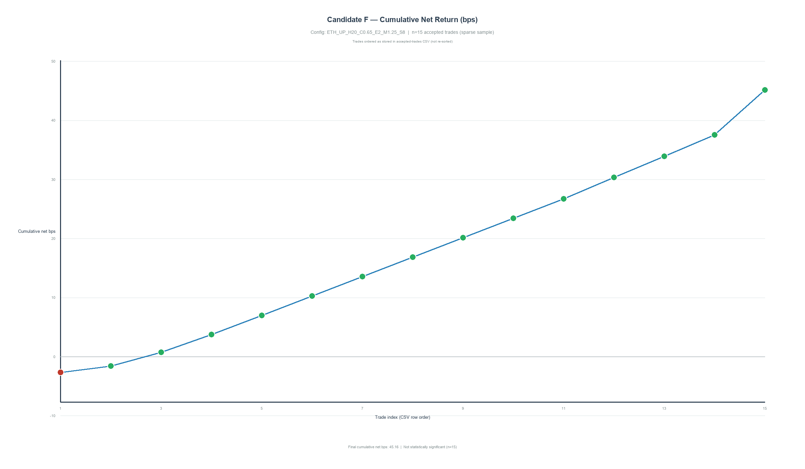
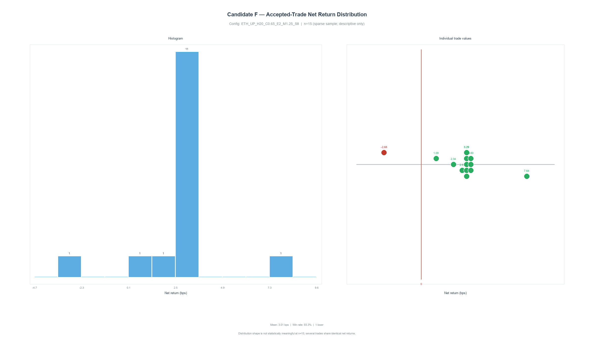
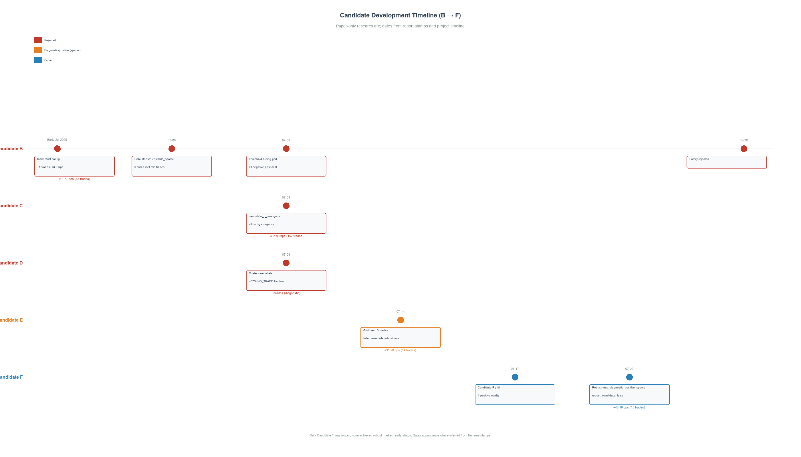
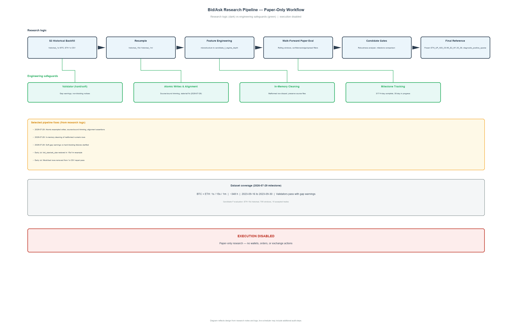

# Hyperliquid BTC/ETH Bid/Ask Microstructure ML — Final Project Report

**Document status:** Paper-only research report.

**Generated:** 2026-08-06  
**Primary evidence base:** Local artifacts listed in Appendix A.

---

## Key Finding

> **Candidate F** (`ETH_UP_H20_C0.65_E2_M1.25_S8`) produced a **positive diagnostic result after estimated costs** (+45.16 cumulative net bps on **15 accepted trades**), but the evidence is **sparse**, **robustness failed** (`robust_candidate: false`), and **baseline improvement was not demonstrated** (`beats_baseline_accuracy: false`). This is **not** evidence of profitability, statistical significance, or market readiness.

---

## Abstract

This report documents a paper-only research project that asked whether machine-learning signals derived from Hyperliquid Level-2 (L2) bid/ask microstructure data for BTC and ETH could produce trade ideas that remain positive after estimated transaction costs. The project built a reproducible data pipeline, iterated through six candidate model families (B through F), and froze one final configuration—**Candidate F**—for diagnostic reference.

In plain terms: the project collected historical order-book snapshots, engineered features from bid/ask prices and sizes, trained classifiers in a walk-forward (time-respecting) protocol, and simulated whether predicted trades would have beaten costs on paper. The **authoritative final walk-forward run** (20260729T101645) produced **15 accepted trades** with **+45.16 cumulative net basis points (bps)** and **+3.01 average net bps**. An earlier **grid/frozen snapshot** of the same config reported **17 trades** at **+28.75 cumulative bps** and **+1.69 average bps**—a different evaluation mode, not a tuning change.

Stored walk-forward evidence records **`model_used: RandomForestClassifier`** for all completed evaluation windows in the final run.

All work remained within explicit safety boundaries: `paper_only: true`, `execution_enabled: false`, `real_execution_ready: false`.

---

## 1. Executive Summary

### 1.1 What this project is

Hyperliquid is a decentralised exchange. Its order book shows the best prices at which participants are willing to buy (bid) and sell (ask). This project tested whether microstructure patterns—spread width, order imbalance, depth at the top of book—combined with machine learning, could identify moments when a simulated **upward** trade on ETH would still be worthwhile **after fees, slippage, and spread**.

The work was deliberately limited to **research simulation**. No wallets, signing, orders, or live exchange endpoints were used.

### 1.2 What was built

Two parallel efforts ran throughout the project:

1. **Model research (Candidates B–F):** A sequence of hypotheses about features, labels, and filters, each evaluated with walk-forward testing and cost-aware gates.
2. **Pipeline engineering:** Infrastructure to backfill historical L2 data from S3, resample 1-second bars to 15-second and 1-minute intervals, validate CSV integrity, and support depth-aware feature computation.

By 2026-07-29, the pipeline reached the **14-day data milestone** but remained at **~48.3% progress toward the 30-day milestone**.

### 1.3 Final outcome — two evidence snapshots

Candidate F metrics must be read from the correct artifact. The **final walk-forward run** is authoritative for evaluation; the **grid search snapshot** is a separate, earlier pipeline mode on the same frozen config.

| Evidence snapshot | Trades | Cumulative net bps | Average net bps | Source |
|-------------------|-------:|-------------------:|----------------:|--------|
| **Final walk-forward** (authoritative) | 15 | +45.16 | +3.01 | `walk_forward_ETH_20260729T101645.json` |
| Grid/frozen snapshot (diagnostic only) | 17 | +28.75 | +1.69 | `candidate_grid_20260717T080653.json` |

Both snapshots are positive but sparse. The trade-count difference (17 vs. 15) reflects **evaluation pipeline differences**, not parameter tuning after freeze.

| Outcome dimension | Result (final walk-forward) |
|-------------------|----------------------------|
| Frozen candidate | F — `ETH_UP_H20_C0.65_E2_M1.25_S8` |
| Classifier | `RandomForestClassifier` (per stored walk-forward windows) |
| Robustness verdict | `diagnostic_positive_sparse` |
| Robust candidate | `false` |
| Baseline improvement | No demonstrated improvement |
| Market readiness | Not claimed; execution disabled |

No candidate B through F achieved robust, baseline-beating paper performance. Candidate F is retained as a **frozen diagnostic reference**, not as a production trading system.

---

## 2. Research Questions

**Primary:** Can microstructure features derived from Hyperliquid BTC/ETH L2 bid/ask data produce **paper-only** trade signals that remain positive after estimated costs (fees + slippage + spread)?

**Secondary:**

1. Which combinations of labeling strategy, feature engineering, and post-prediction filters survive walk-forward evaluation and robustness checks?
2. What pipeline and validation infrastructure is required to test such claims honestly without live execution?

---

## 3. Project Scope and Paper-Only Safeguards

### 3.1 What the project does

- Collects and validates historical bid/ask CSV data for BTC and ETH at 1s, 15s, and 1m intervals.
- Engineers microstructure, depth, and regime features from validated bars.
- Trains classifiers (`RandomForestClassifier`, per stored walk-forward evidence) in rolling walk-forward windows.
- Applies post-prediction filters (confidence, edge, spread, trade class) before counting an **accepted trade**.
- Computes **net returns in basis points** after an estimated cost model.
- Runs robustness diagnostics (trade count, temporal concentration, regime concentration, milestone comparison).

### 3.2 What the project explicitly does not do

- Connect wallets, sign transactions, or submit orders.
- Enable leverage, margin, deposits, withdrawals, or exchange execution endpoints.
- Claim statistical significance, profitability, or live-trading readiness.
- Tune Candidate F after the 2026-07-29 freeze.

Every cited final artifact carries consistent safety flags:

| Flag | Value |
|------|-------|
| `paper_only` | `true` |
| `execution_enabled` | `false` |
| `real_execution_ready` | `false` |

Simulated returns exist to **design and validate research methodology**, not to prove that a strategy would profit in live markets.

---

## 4. Data Collection and Validation

### 4.1 Overview

Historical Hyperliquid L2 bid/ask data was backfilled via Requester Pays S3 into local CSV archives under `data/bid_ask_csv/`. The canonical 1-second files were resampled to 15-second and 1-minute bars for model training. Validators checked schema, timestamps, and gap warnings before features or walk-forward runs consumed the data.

### 4.2 Coverage: 348 h vs. 351 h — different artifact snapshots

**348 hours** and **351 hours** are **not identical** coverage figures. They come from different artifact snapshots with different CSV timestamp bounds:

| Snapshot | Coverage (h) | ETH 15s last timestamp | Artifact |
|----------|-------------:|------------------------|----------|
| Backfill milestone tracker | 348.0 | 2023-09-30T11:59:45Z | `backfill_milestones_latest.json` |
| Final walk-forward evaluation | **351.0** | **2023-09-30T14:59:45Z** | `walk_forward_ETH_20260729T101645.json`, milestone comparison |

The backfill milestone report captured dataset state at an earlier snapshot (~14 days, ending mid-day on 2023-09-30). The final walk-forward run consumed a slightly extended ETH 15s CSV slice (~3 additional hours). **Treat the 351-hour walk-forward bounds as authoritative for Candidate F evaluation.**

**Table 5** summarises milestone-tracker coverage (348 h snapshot):

| Coin | Interval | Coverage (h) | First timestamp | Last timestamp | Validator passed |
|------|----------|-------------:|-----------------|----------------|:----------------:|
| BTC | 1s | 347.998 | 2023-09-16T00:00:05.332Z | 2023-09-30T11:59:59.480Z | yes |
| BTC | 15s | 348.0 | 2023-09-16T00:00:00Z | 2023-09-30T11:59:45Z | yes |
| ETH | 15s | 348.0 | 2023-09-16T00:00:00Z | 2023-09-30T11:59:45Z | yes |
| ETH | 1m | 348.0 | 2023-09-16T00:00:00Z | 2023-09-30T11:59:00Z | yes |

**Milestone progress (all coin/interval pairs):** 3-day ✓, 7-day ✓, 14-day ✓, **30-day ✗ (~48.33% complete)**.

### 4.3 Validation warnings

Validators **passed** for all six primary files but emitted expected gap warnings—for example, ETH 15s reported **13,242** incomplete periods. These are **soft warnings** that document missing intervals without blocking the pipeline.

---

## 5. Mathematical and Statistical Methods

This section explains how mathematics enters the project: plain language first, then formulas and thresholds from artifacts.

### 5.1 Returns and basis points

A **return** measures how much a price changed over a holding period. Returns are expressed in **basis points (bps)**, where **1 bps = 0.01%**.

For each accepted paper trade, the walk-forward engine records **gross return** (before costs) and **net return** (after estimated costs). Candidate F's **cumulative net bps** (+45.16) is the **sum** across all 15 accepted trades. **Average net bps** (+3.01) is that sum divided by 15.

### 5.2 Spread and transaction costs

The **spread** is the gap between best ask and best bid. Candidate F blocks trades when spread exceeds **8 bps** (`max_spread_bps: 8.0`). In the final run, **8 predictions** were blocked by spread filters; all 15 accepted trades fell in **tight_spread_regime** (100%).

Estimated cost:

```
estimated_cost_bps = fee_bps + slippage_bps + spread_bps
net_return_bps ≈ gross_return_bps − estimated_cost_bps
```

Average cost bps across evaluation windows: **≈ 6.42**. On accepted UP trades specifically: **≈ 3.75**. Filters apply a **cost multiplier** of **1.25** on edge thresholds.

### 5.3 Volatility and regime breakdowns

Candidate F's feature set includes **realised volatility** and classifies bars into **low** vs. **high volatility regimes**. Robustness artifacts report **13 of 15** accepted trades (86.7%) in **low_volatility_regime**; **zero** in high-volatility regime.

**Important caveat:** Regime-subset cumulative figures may **not sum to the trade total**. The robustness report lists low_volatility_regime cumulative net bps as **+46.76** across 13 trades—**exceeding** the authoritative 15-trade total of **+45.16 bps**. This suggests overlapping or differently grouped regime subsets; **volatility-regime aggregation remains unverified**. **Use the 15-trade total (+45.16 bps) as authoritative.** Do not draw conclusions from unverified regime cumulative figures.

Absence of trades in a regime is **not** evidence of negative edge—it may reflect filter interaction with a short sample.

### 5.4 Probabilities and confidence

The Random Forest outputs **class probabilities** per bar. Candidate F requires **minimum confidence 0.65** (`min_confidence: 0.65`). In the final run, **1,376** UP-class predictions were blocked for insufficient confidence.

Accepted trades averaged **≈ 0.923** model-reported confidence. This is a **Random Forest score**, not a calibrated probability of future correctness. With only 15 trades, this average is a descriptive statistic only.

### 5.5 Walk-forward windows

**Walk-forward evaluation** trains on past bars and predicts subsequent bars, rolling forward through history without peeking at future data.

Candidate F's final run processed **705 total windows**: **695 completed**, **10 skipped**. Per artifact `skipped_window_reasons`, all 10 skips were **`one_class_training_window`**—training labels contained only one class.

### 5.6 Cumulative vs. average return

- **Cumulative net bps:** sum of all accepted-trade net returns → **+45.16 bps** (15 trades).
- **Average net bps:** cumulative divided by trade count → **+3.01 bps**.

With sparse trades, a few large winners can lift cumulative return while average return remains modest.



*Figure 1. Cumulative net return (bps) across 15 accepted Candidate F paper trades after estimated costs, ordered exactly as stored in the accepted-trades CSV. Config `ETH_UP_H20_C0.65_E2_M1.25_S8`. Final cumulative net bps: +45.16.*

### 5.7 Robustness gates

Robustness here means: would modest changes in time period, regime mix, or evaluation rerun still support the same conclusion? The project applies **qualitative and count-based** gates—not formal statistical hypothesis tests (which are **unavailable** in the artifact set).

Criteria include minimum accepted trade count (target **≥ 30**; Candidate F has **15**), temporal/regime concentration, grid-vs-walk-forward comparison, and baseline accuracy (`beats_baseline_accuracy`). Candidate F fails: verdict **`diagnostic_positive_sparse`**, **`robust_candidate: false`**.

### 5.8 Classifier and filter pipeline

| Stage | Candidate F setting |
|-------|---------------------|
| Classifier | `RandomForestClassifier` (`model_used` in walk-forward JSON) |
| Feature set | `candidate_f_regime_depth` (34 features) |
| Label mode | `binary_tradeable_up` |
| Horizon | 20 bars (15s each ≈ 5 minutes) |
| min_confidence | 0.65 |
| min_edge_bps | 2.0 |
| cost_multiplier | 1.25 |
| max_spread_bps | 8.0 |
| trade_class | UP only |

**Block breakdown (final run):** 67,572 FLAT-class blocks, 1,913 UP-class blocks, 1,376 blocked by confidence, 529 by cost, 8 by spread.

---

## 6. Feature Engineering

| Candidate | Feature set | Description |
|-----------|-------------|-------------|
| B | `microstructure` | Basic bid/ask microstructure; post-hoc direction filters |
| C | `candidate_c_core` | Spread regime, imbalance dynamics, returns, time features |
| D | *(label infrastructure)* | No standalone feature set; reframed labels |
| E | `candidate_e_depth_aware` | Extends C with bid/ask size, microprice, size imbalance |
| F | `candidate_f_regime_depth` | 34 features: E + realised vol, spread/vol regimes, interactions |

Candidate F adds **regime-aware** features so the model can distinguish tight-spread low-volatility conditions from wide-spread high-volatility conditions—the main methodological advance over Candidate E.

---

## 7. Labeling and Cost Assumptions

**Direction labels (B, C):** Early candidates labelled bars by price direction regardless of cost coverage. Candidate C's best grid config averaged **−2.79 bps** across 157 trades—all grid configs negative after costs.

**Cost-aware labels (D):** Introduced `cost_aware_3class` and `binary_tradeable_up`/`down`. Candidate D produced **zero accepted trades** as a trading family but clarified that most bars should not be traded (~66.7% NO_TRADE under 3-class diagnostics).

**Binary tradeable labels (E, F):** A bar is labelled positive only if a hypothetical UP trade would exceed a **threshold** after costs. Candidate F uses **`threshold_bps: 1.0`**, **`horizon_bars: 20`**. Label diagnostics show **≈ 85.0% NO_TRADE fraction** (`no_trade_fraction: 0.8496`)—consistent with only 15 accepted trades from 705 windows.

---

## 8. Walk-Forward Evaluation

Walk-forward evaluation rolls a training window through historical 15-second ETH bars, fits the classifier, predicts the next segment, applies filters, and records accepted trades with net returns.

### 8.1 Candidate F final run (20260729T101645)

**Table 2** lists the frozen configuration. **Table 3** lists final metrics.

**Table 2 — Candidate F Frozen Configuration**

| Field | Value |
|-------|-------|
| config_id | `ETH_UP_H20_C0.65_E2_M1.25_S8` |
| coin | ETH |
| interval | 15s |
| horizon | 20 |
| trade_class | UP |
| feature_set | `candidate_f_regime_depth` |
| label_mode | `binary_tradeable_up` |
| min_confidence | 0.65 |
| min_edge_bps | 2.0 |
| cost_multiplier | 1.25 |
| max_spread_bps | 8.0 |

**Table 3 — Candidate F Final Walk-Forward Metrics**

| Metric | Value |
|--------|------:|
| Report stamp | 20260729T101645 |
| Dataset bounds (authoritative) | 2023-09-16T00:00:00Z → 2023-09-30T14:59:45Z (351 h) |
| total_windows | 705 |
| completed_windows | 695 |
| skipped_windows | 10 (all `one_class_training_window`) |
| accepted_trades | 15 |
| cumulative_net_bps | +45.16 |
| average_net_bps | +3.01 |
| win_rate | 0.933 (14 wins, 1 loss) |
| beats_baseline_accuracy | false |
| baseline_accuracy_mean | 0.848 |
| accuracy_edge_vs_baseline | −0.0106 |
| average_cost_bps | 6.42 |
| robustness_verdict | `diagnostic_positive_sparse` |
| robust_candidate | false |

The model's classification accuracy **does not beat** a simple baseline that always predicts the majority class (~84.8% accuracy). Positive net bps on accepted trades reflects **filtering and trade selection**, not overall predictive superiority.



*Figure 2. Distribution of net returns (bps) for 15 Candidate F accepted paper trades (config `ETH_UP_H20_C0.65_E2_M1.25_S8`). Histogram (left) and individual trade values (right). One trade (−2.68 bps) is the sole loser; mean net return is +3.01 bps.*

---

## 9. Candidate B–F Development

**Table 1 — Candidate B–F Comparison**

| Candidate | Status | Feature / method | Coin / interval | Trades | Cum. net bps | Avg net bps | Robust | Outcome |
|-----------|--------|------------------|-----------------|-------:|-------------:|------------:|:------:|---------|
| **B** | rejected | microstructure + direction filters | BTC / 15s | 63 | +11.77 | +0.19 | no | Early signal did not scale |
| **C** | rejected | `candidate_c_core` + direction labels | BTC, ETH / 15s | 157* | −437.98* | −2.79* | no | All grid configs negative |
| **D** | rejected | cost-aware / binary tradeable labels | BTC, ETH / 15s | 0 | 0.00 | 0.00 | n/a | Diagnostic labels only |
| **E** | diagnostic_positive_sparse | `candidate_e_depth_aware` + binary_tradeable_up | ETH / 15s H20 | 14 | +31.28 | +2.23 | no | Positive but sparse |
| **F** | frozen | `candidate_f_regime_depth` + binary_tradeable_up | ETH / 15s H20 | **15** | **+45.16** | **+3.01** | no | Final walk-forward; no baseline improvement |

\*Candidate C metrics from best-ranked grid config; **all grid configs were negative**.

*Table 1 caption:* Candidate F row reflects the **final walk-forward run**, not the earlier grid snapshot (17 trades, +28.75 bps). Positive cumulative net bps after estimated costs do not imply robustness or market readiness.

**Narrative arc:** B tested strict filters on BTC—rejected as unstable/sparse. C pivoted to richer features under direction labels—all negative. D reframed around cost-aware abstention—zero trades but label infrastructure for E/F. E added depth features—14 trades, +31.28 bps, failed min-trade threshold. F extended E with regime-depth interactions—frozen 2026-07-29 as final diagnostic reference.



*Figure 3. Chronological development of Candidates B through F on paper-only walk-forward and grid evaluation. Color coding: red = rejected, orange = diagnostic-positive (sparse), blue = frozen. Only Candidate F was frozen; none achieved robust market-ready status.*

---

## 10. Candidate F Final Results

### 10.1 Sample size caveat

**The 15-trade sample is too small for strong statistical claims.** Win rate (93.3%), average return (+3.01 bps), and cumulative return (+45.16 bps) are **descriptive summaries only**. Formal hypothesis tests and confidence intervals are **unavailable** in the current artifact set.

### 10.2 Trade concentration

| Dimension | Dominant value | Fraction |
|-----------|----------------|----------:|
| Calendar day | 2023-09-23 | 86.7% (13/15) |
| UTC hour | 14 | 86.7% (13/15) |
| Volatility regime | low_volatility_regime | 86.7% (13/15) |
| Spread regime | tight_spread_regime | 100% (15/15) |

Excluding the dominant day (2023-09-23) leaves **2 trades** totalling **+4.96 cumulative net bps**—far too few to support generalisation. *(Source: milestone comparison artifact.)*

| Date | Trades | Cumulative net bps |
|------|-------:|-------------------:|
| 2023-09-21 | 1 | −2.68 |
| 2023-09-23 | 13 | +40.21 |
| 2023-09-27 | 1 | +7.64 |

---

## 11. Robustness Analysis

### 11.1 Overall verdict

**Table 4 — Candidate F Robustness Summary**

| Field | Value |
|-------|-------|
| overall_verdict | `diagnostic_positive_sparse` |
| robust_candidate | `false` |
| trade_count | 15 |
| cumulative_net_bps | +45.16 |
| win_rate | 0.933 |
| dominant_day | 2023-09-23 (86.7%) |
| dominant_utc_hour | 14 (86.7%) |
| excluding_dominant_day trades | 2 |
| excluding_dominant_day cumulative_net_bps | +4.96 |
| top_1_trade_contribution_pct | 15.97% |
| top_3_trades_contribution_pct | 31.02% |
| next_recommended_action | Continue paper-only data collection until ≥30 accepted trades |

*Table 4 caption:* Verdict reflects sparse trade count and temporal/regime concentration, not statistical significance. Dominant-day exclusion metrics from milestone comparison artifact.

### 11.2 Grid vs. walk-forward — distinct snapshots

The **grid 17-trade result is separate from the final 15-trade walk-forward result**. Both use the same frozen `config_id` but different evaluation modes:

| Metric | Grid snapshot (20260717T080653) | Final walk-forward (20260729T101645) |
|--------|--------------------------------:|-------------------------------------:|
| accepted_trades | 17 | 15 |
| cumulative_net_bps | +28.75 | +45.16 |
| average_net_bps | +1.69 | +3.01 |
| win_rate | 0.765 | 0.933 |

Both positive but sparse. The trade-count mismatch reflects pipeline differences between grid and walk-forward modes—not post-freeze tuning.

### 11.3 Milestone comparison

The milestone comparator collapsed **four duplicate walk-forward reruns** (20260723–20260729) with identical 351-hour dataset bounds into **one valid milestone**. This confirms reproducibility on the same data slice but does not expand temporal coverage.

---

## 12. Pipeline Engineering Findings

Model research and pipeline engineering were **interdependent**. Depth-aware and regime features (E, F) required reliable `bid_size`, `ask_size`, and resampled bar alignment.

**Table 6 — Major Pipeline Failures and Fixes**

| Date (approx.) | Problem | Fix / outcome |
|----------------|---------|---------------|
| Early Jul 2026 | Mock/bad rows in 1s CSV | Repair pass: dedupe timestamps, remove mock rows |
| Early Jul 2026 | `bid_size`/`ask_size` dropped in resample | Last-valid 1s tick carried into 15s/1m bars |
| 2026-07-15 | Scheduler ticks timing out | 90-minute tick timeout added |
| 2026-07-29 | Stale 15s/1m tails after 1s updates | Atomic resampled writes, source-bound trimming |
| 2026-07-29 | Malformed numeric rows | In-memory cleaning; preserve source files |
| 2026-07-29 | Soft vs hard validation | Gap warnings non-blocking; hard failures block pipeline |

On 2026-07-29, stale-tail regression tests passed and frozen Candidate F was rerun **without configuration changes**, producing the final evidence set.



*Figure 4. Paper-only bid/ask research pipeline: S3 backfill → 1s CSV → resample → validate → features → walk-forward → candidate gates. Dark boxes = research logic; green boxes = engineering safeguards. Execution paths disabled.*

---

## 13. Limitations

1. **Sample size:** 15 accepted trades; below the 30-trade robustness target.
2. **Temporal concentration:** 86.7% of trades on a single calendar day.
3. **Dataset span:** ~14.6 days at walk-forward bounds (351 h); 30-day milestone not met (~48.3%).
4. **Single coin/class:** ETH UP H20 only; BTC and DOWN not validated at freeze.
5. **Cost model:** Estimated fees/slippage/spread; not live fill simulation.
6. **Baseline:** Model does not beat baseline accuracy; no demonstrated baseline improvement.
7. **Regime aggregation unverified:** Low-volatility subset cumulative (+46.76 bps) exceeds trade total (+45.16 bps).
8. **Missing robustness artifacts:** No rolling-slice report for Candidate C; no `candidate_e_robustness` analogous to F.
9. **No formal significance testing** in artifacts.
10. **Regime coverage gaps:** Zero accepted trades in high-volatility or wide-spread regimes.

---

## 14. Conclusion

This project tested whether Hyperliquid L2 bid/ask microstructure could support cost-aware, paper-only trade signals. From existing evidence:

1. **Pipeline success:** Reproducible paper-only pipeline built; 14-day milestone reached with passing validators.
2. **Model research:** Six candidate families (B–F) tested with increasing discipline. **None** achieved robust, baseline-beating paper performance.
3. **Candidate F (frozen):** Final walk-forward shows a **diagnostic** post-cost positive signal (+45.16 cumulative net bps on 15 trades) with **`diagnostic_positive_sparse`** verdict and **`robust_candidate: false`**. No demonstrated baseline improvement. **Not** profitability proof. **Not** market readiness. **Not** statistical significance.
4. **Next step (from artifacts):** Continue **paper-only data collection** until **≥ 30 accepted trades**—not further tuning on the frozen config.

Real execution should remain **disabled**.

---

## 15. Future Work

1. **Extend historical coverage** toward the 30-day milestone (~720 hours; currently ~48.3% complete).
2. **Accumulate ≥ 30 accepted trades** before revisiting robustness verdicts.
3. **Formal out-of-sample held-out date block** when sufficient calendar span exists.
4. **Dedicated robustness reports** for Candidates C and E—currently **unavailable**.
5. **Statistical inference framework**—currently **unsupported** by artifacts.

No item above authorises enabling execution or tuning the frozen Candidate F config.

---

## Appendix A — Source Artifacts

| Artifact | Role |
|----------|------|
| `reports/final_project_evidence/final_metrics_table.md` | Final metrics |
| `reports/final_project_evidence/candidate_f_final_summary.json` | Frozen summary |
| `reports/final_project_evidence/figures/figure_manifest.json` | Figure manifest |
| `reports/bid_ask_walk_forward/walk_forward_ETH_20260729T101645.json` | Final walk-forward |
| `reports/bid_ask_walk_forward/accepted_trades_ETH_20260729T101645.csv` | Accepted trades |
| `reports/candidate_f_robustness/candidate_f_robustness_latest.json` | Robustness |
| `reports/candidate_f_milestone_comparison/candidate_f_milestone_comparison_latest.json` | Milestones |
| `reports/backfill_milestones/backfill_milestones_latest.json` | Data coverage (348 h snapshot) |
| `reports/candidate_grid/candidate_grid_20260717T080653.json` | Grid snapshot (17 trades) |

---

## Appendix B — Evidence-Generation Scripts

Scripts that produced cited artifacts (not re-executed for this report):

| Script | Primary output |
|--------|----------------|
| `bid_ask_backfill_milestone_tracker.py` | `backfill_milestones_latest.json` |
| `bid_ask_walk_forward.py` | `walk_forward_ETH_20260729T101645.json` |
| `candidate_f_robustness_analyzer.py` | `candidate_f_robustness_latest.json` |
| `candidate_f_milestone_comparison.py` | `candidate_f_milestone_comparison_latest.json` |

---

## Appendix C — Figure and Table Index

### Figures

| Figure | Filename | Title |
|--------|----------|-------|
| Figure 1 | `candidate_f_cumulative_net_bps.png` | Candidate F cumulative net bps |
| Figure 2 | `candidate_f_return_distribution.png` | Candidate F return distribution |
| Figure 3 | `candidate_development_timeline.png` | Candidate B–F development timeline |
| Figure 4 | `data_pipeline_workflow.png` | Data-pipeline workflow |

### Tables

| Table | Title | Primary source |
|-------|-------|----------------|
| Table 1 | Candidate B–F Comparison | `candidate_history.md`, walk-forward JSON |
| Table 2 | Candidate F Frozen Configuration | milestone comparison JSON |
| Table 3 | Candidate F Final Walk-Forward Metrics | `candidate_f_final_summary.json` |
| Table 4 | Candidate F Robustness Summary | robustness + milestone comparison JSON |
| Table 5 | Dataset Coverage (348 h snapshot) | `backfill_milestones_latest.json` |
| Table 6 | Major Pipeline Failures and Fixes | research logs |

---

## Reproducibility Statement

This report was generated from stored local artifacts. No models were rerun during report preparation. Real execution remained disabled.

---

*End of final report. Generated 2026-08-06 from existing local evidence only.*
